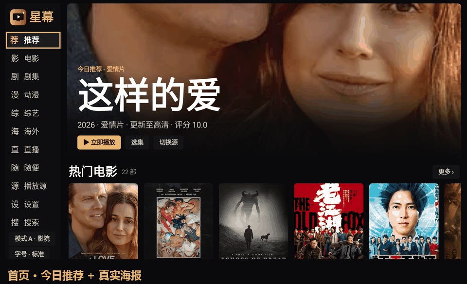
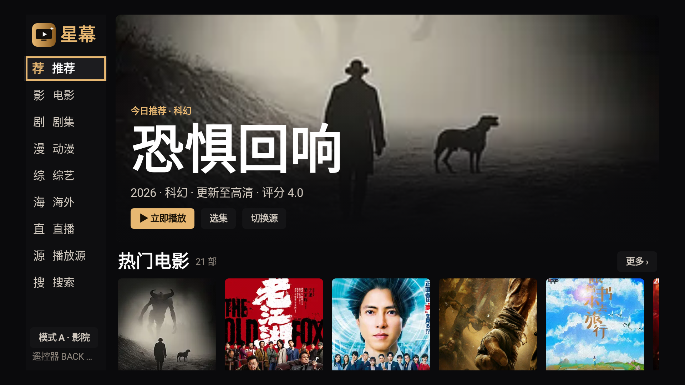
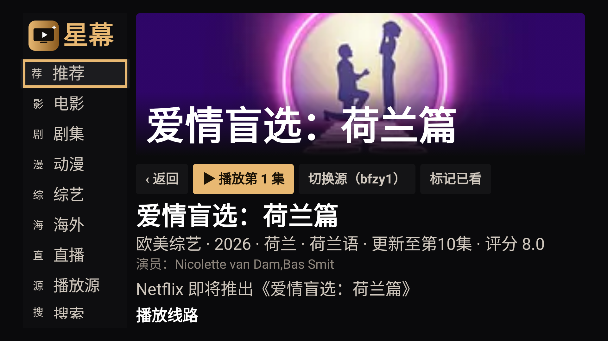
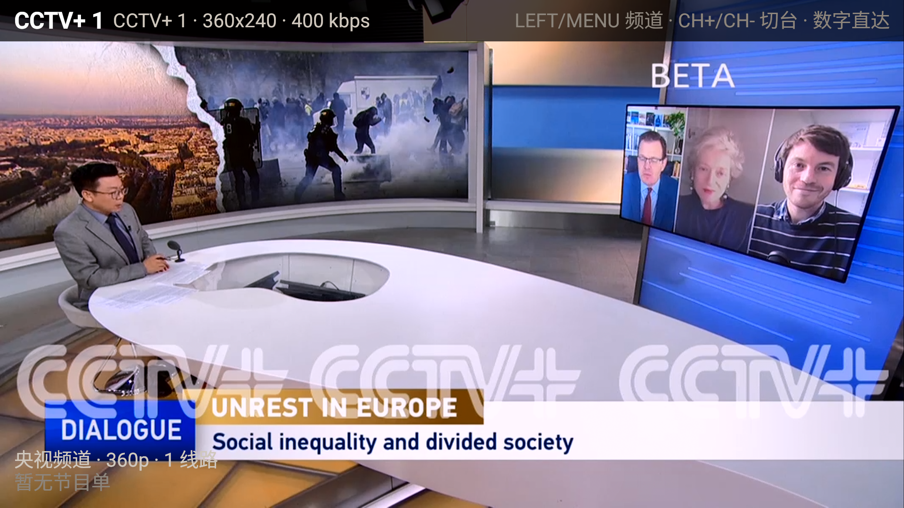
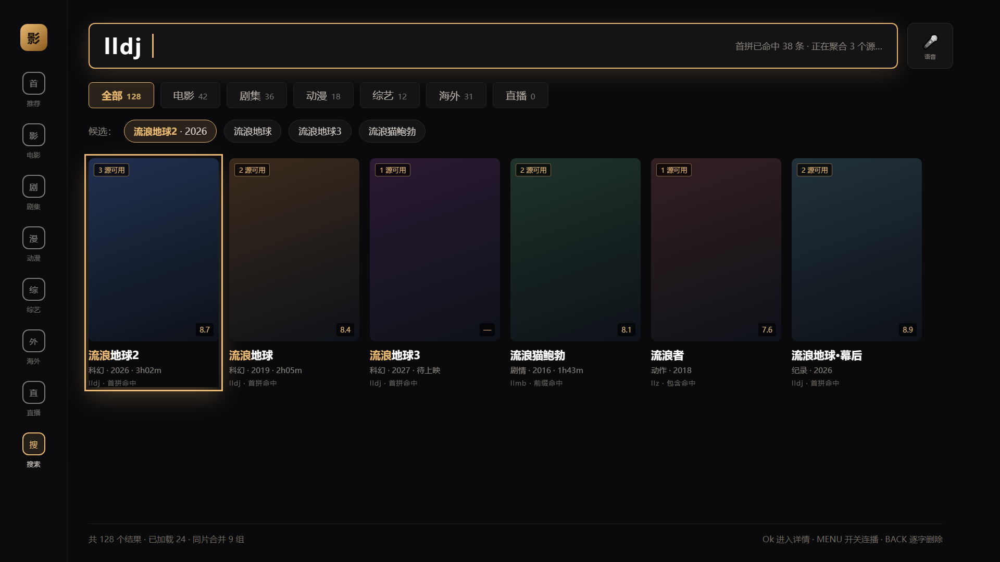
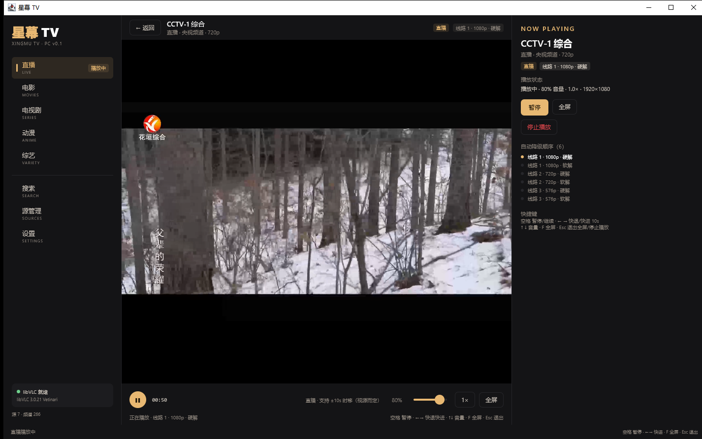

# 星幕 TV · Xingmu TV

**你家的老电视，还没到退休的年纪。**


> 开源安卓电视 / 电视盒子影视客户端：直播、电影、剧集、动漫、综艺、海外剧，外加「随便听听看看」。
> 非商业、公益性质；不托管、不分发任何视频内容。

`Android 5.0+` · `APK 2.9MB（R8）` · `无 GMS 依赖` · `Kotlin + Compose + Media3` · `MIT`



> 以上为真机截图轮播；单张静图见 [docs/screenshots](docs/screenshots)。

## 为什么是星幕

现在很多「电视优化 / 去广告桌面」方案都写着 **Android 8.0 起**，2016 年的电视、运营商送的老盒子、酒店/出租屋的机器，直接就被排除在外了。

星幕反着做：**minSdk 21（Android 5.0）**，并在一台 2016 年的 **LeTV 超4 X50（Android 6 / MStar 6A938 / 2.87GB 内存 / 1080p）** 上逐项实测过——不是模拟器，是真机跑的：

| 能力 | 实测结果 |
| --- | --- |
| 系统兼容 | Android 5.0 起可装；Android 6 上首页/分类/详情/搜索/直播/播放/设置全部跑通 |
| 冷启动 | **995ms** 首屏 |
| 内存占用 | 浏览 PSS **68MB**，播放 PSS **74.8MB**（10 分钟采样） |
| 播放掉帧 | **0.61%**（修掉模式误判后） |
| 老芯片解不动 1080p | **自动识别 + 降到 720p 安全档**，不黑屏、不闪退 |
| 详情页 | 缓存命中 **18ms**，常态 0.4–1.8s |
| 切台 | 快 CDN 频道首帧 **584ms**（CCTV-5 实测） |
| 包体 | **2.9MB**（R8 + 资源裁剪，debug 包 12.2MB） |

一句话：**只要你的电视能装 APK，它基本就能跑星幕。**

## 这是什么

星幕 TV 是一个**壳**，不是内容站：

- 它只做三件事：**把公开的影视接口聚合起来**、**把播放体验做好**、**把不可靠的网络源兜住**。
- 播放源由用户自己导入（MacCMS 接口 / m3u 直播源 / 订阅合集），也可以直接用内置的演示源。
- 针对**低配电视盒子**（1GB 内存、老 SoC、Android 6）做了专门的取舍，而不是把手机 App 塞进电视。

## 功能

### 点播
- 多源聚合：一个作品跨站合并，显示「N 个源可用」，缺集自动置灰
- 分类：电影 / 剧集 / 动漫 / 综艺 / **海外（韩剧·美剧·日剧·泰剧·港台）** / 短剧
- 选集：60 集以上自动分页、倒序、已看标记、播放中不退出切集
- 搜索：**首拼搜索**（`lldq` → 流浪地球）、分段结果、命中高亮、同片合并

### 直播
- 内置 **266 个频道 / 396 条源**，每条源带实测分辨率；低端设备自动进入安全模式（163 个 ≤720p 频道）
- **高清专区 114 个 ≥1080p 频道**，含 3 个真 4K 频道（3840×2160，实测）
- 全屏播放 + 半透明频道浮层、`CH+/CH-` 切台、数字键直达、断流自动切备用线路

### 播放器
- Media3 / ExoPlayer，硬解优先 + 解码回落，SurfaceView 直出
- 音画同步：音频主时钟、关 offload、Sonic 倍速、AudioTrack 缓冲 ≥400ms
- 倍速 5 档、±10s / 长按连续 seek、画质与线路三合一面板、音画校准 ±500ms
- 广告治理：只走 JSON 接口不加载网页 + 域名黑名单 + 片头跳过

### 体验
- 三档显示模式：**A 影院**（深色 + 金色）/ **C 保命**（纯黑高对比，低端机）/ **大字号**（1.3×，近视友好）
- 屏幕适配：960dp 基线，按 widthDp 分 4/5/6 列，Hero 高度按屏高比例，过扫描可调
- 源导入：**手机扫码**（局域网网页粘贴/传文件）/ 配对码 / U 盘 / 遥控器键盘

## 截图

| 首页 | 详情 |
| --- | --- |
|  |  |

| 直播 | 搜索 |
| --- | --- |
|  |  |

| 大字号模式 |
| --- |
|  |

## 技术架构

```
app/
├── data/            多源聚合、MacCMS 客户端、SWR 缓存、拼音索引
├── ui/              Compose 页面（首页/分类/详情/搜索/直播/播放/源管理/设置）
├── player/          Media3 封装：单实例、硬解回落、音画同步、降码降档
├── live/            频道列表、切台状态机、EPG、备用源
├── source/          源仓库（SQLite）、校验管线、聚合搜索
└── import/          局域网导入服务、二维码、U 盘/SAF、键盘契约
```

- Kotlin 2.0 + Jetpack Compose（只用 foundation/ui，不引 Material3，控包体）
- Media3 1.5.1（ExoPlayer + HLS）、OkHttp 4.12、Coil 2.7
- minSdk 21 / targetSdk 34，真机验证：LeTV 超4 X50（Android 6 / 1080p / MStar 6A938）

## 下载

| 渠道 | 说明 |
| --- | --- |
| **Releases · 标准包**（推荐） | [v0.2.6](https://github.com/OugeX/xingmu-tv/releases/tag/v0.2.6) 的 `xingmu-tv-v0.2.6-*.apk`（12.2MB），已在真机 LeTV 上逐项验证 |
| **Releases · 精简包** | 同页 `*-r8-*.apk`（**2.86MB**，R8 + 资源裁剪），体积小 76%，仅在 Android TV 模拟器验证过安装/启动/渲染，真机四链路待验 |
| CI 产物 | 每次提交由 GitHub Actions 构建，可在 Actions → build → Artifacts 下载（保留 30 天） |
| **不会装？** | 看 [老电视复活指南](docs/老电视复活指南.md)：开 ADB、连电视、装 APK、配源，一步一图 |

> 当前为 debug 签名，仅供侧载测试；正式发布前会换 release 签名。Android 5.0+（minSdk 21）。

## 快速开始

**环境**：JDK 17、Android SDK 34+、Gradle 8.7

```bash
# 1. 配置 SDK 路径
echo "sdk.dir=/path/to/android-sdk" > local.properties

# 2. 构建
gradle assembleDebug --no-daemon
# 产物：app/build/outputs/apk/debug/app-debug.apk

# 3. 安装到电视（需开启 ADB 调试）
adb connect 192.168.1.9:5555
adb install -r app/build/outputs/apk/debug/app-debug.apk
```

## PC 客户端（desktop/）

Windows / macOS 桌面客户端 v0.1：**Compose Multiplatform Desktop + libVLC(vlcj)**，独立 Gradle 工程 `desktop/`，
不修改 Android 构建、`app/` 与仓库根构建脚本。



- **三栏式桌面布局**：左侧导航（直播/电影/电视剧/动漫/综艺/搜索/源管理/设置）、中部列表或播放器、右侧详情与线路/剧集。
- **直播 + 点播**：复用 `assets/live_seed.json`（266 频道）与 MacCMS 源；libVLC 播放 HLS 直播与 mp4/m3u8 点播，支持暂停、seek、音量、0.5×–2× 倍速、全屏。
- **1080p 黑屏降级**：每条线路按「硬解 → 软解 → 更低清晰度线路」自动重试，并在右侧展示降级阶梯。
- **键盘快捷键**：`空格` 暂停、`←/→` 快退/快进 10s、`↑/↓` 音量、`F` 全屏、`Esc` 退出。
- **源管理**：本地 JSON / 粘贴文本 / URL 导入，错误码与 `tools/validate_sources.py` 一致。
- 数据层纯 JVM：MacCMS `ac=list/detail`、多源聚合搜索、SWR 文件缓存、UA/Referer 与 Android 端一致；
  内置 `assets/sources.builtin.json`、`assets/live_seed.json` 直接相对引用，不复制。
- 暗色主题与 Android A 影院模式一致（`#0A0A0C` + `#E8B872`）。

```bash
# 需要 JDK 17 + VLC 3.x
cd desktop
./gradlew run                      # 起窗
./gradlew run --args="--smoke"     # 非交互自检（数据链路 + 实播直播/点播）
./gradlew packageMsi               # Windows 安装包（Compose 插件自动下载 WiX 3）
./gradlew packageDmg               # macOS .dmg（需在 macOS 上执行）
```

本机验证产物：`desktop/build/compose/binaries/main/msi/XingmuTV-0.1.0.msi`（57,760,138 bytes）、
`desktop/build/compose/binaries/main/exe/XingmuTV-0.1.0.exe`（58,420,736 bytes）。

详细说明、验证记录与已知限制见 [`desktop/README.md`](desktop/README.md)。

### PC 客户端依赖 libVLC

桌面端播放器使用系统安装的 **libVLC 3.x**（vlcj 4.8.2 只是 JVM 绑定，不含原生库）：

| 平台 | 获取方式 | 自动检测位置 |
| --- | --- | --- |
| Windows | 安装 [VLC 3.0.x 64 位](https://www.videolan.org/vlc/)；或用 portable zip 解压 | `%ProgramFiles%\VideoLAN\VLC`、`%ProgramFiles(x86)%\VideoLAN\VLC`、`%LOCALAPPDATA%\Programs\VideoLAN\VLC`、`PATH` |
| macOS | 把 `VLC.app` 放入 `/Applications` | `/Applications/VLC.app/Contents/MacOS/lib`、`/opt/homebrew/lib`、`/usr/local/lib` |

找不到原生库时应用不会崩溃：窗口和列表可正常使用，播放会提示未找到 libVLC；可在
「设置 → libVLC 播放器」填写 VLC 安装目录，或设置环境变量 `TVAPP_VLC_HOME`（也支持 `VLC_HOME`）。
Windows MSI 目前不内置 libVLC（体积/许可证考虑），把 VLC 目录复制到应用可执行文件旁的 `vlc/`
子目录即可被检测；正常安装 VLC 的机器无需任何配置。

## 数据与源

| 文件 | 说明 |
| --- | --- |
| `assets/sources.builtin.json` | 内置演示源（7 个，均经实测可用） |
| `assets/sources.schema.json` | 源配置协议 `tvapp.source.v1.1` |
| `assets/live_seed.json` | 直播频道种子（266 频道 / 396 源，每条源带实测分辨率与 safe 档） |
| `assets/live_safe.json` | 低端设备安全档：163 个频道有 ≤720p 源，103 个仅 1080p 附原因 |
| `assets/live_hd.json` | 高清专区（实测 ≥1080p 的 114 个频道） |
| `assets/pinyin_initials.json` | 首拼索引用的汉字→首字母表（6763 字，含多音字） |
| `assets/casual_radio.json` | 「随便听听」电台（实测可用 39 个） |

源探测工具：`tools/probe_sources.py`、`tools/probe_live_quality.py`、`tools/validate_sources.py`。

## 路线图

### 已完成（v0.2.4，真机 LeTV X4-50 / Android 6 验证）

- [x] **Android TV 客户端**：直播 + 点播 + 多源导入（扫码 / 配对码 / 文件 / 键盘）
- [x] **播放器兼容与提速**：>720p 在 MStar 设备自动进安全档（不再黑屏）、详情页预热（首帧 749–927ms）、详情缓存（命中 18ms）、切台预热与双源竞速
- [x] **首页冷启动骨架**：加载态 + 失败可重试，不再白屏
- [x] **随便听听看看**：39 个电台（Radio Browser + SomaFM）+ B 站公开榜单短视频，播完自动下一条
- [x] **设置中心**：大字号三档 / 过扫描 / C 模式 / 4K 优先 / 硬解优先 / 画质上限 / 音画校准 ±500ms / 字幕字号 / 自建 ASR
- [x] **界面细节**：封面失败自动重试 + 占位图、分类页脚状态互斥、焦点边界（不退出应用）
- [x] **PC 客户端（Windows）**：Compose Desktop + libVLC，MSI/EXE 安装包已随 Release 提供
- [x] **自动构建**：GitHub Actions 产出 APK，打 `v*` tag 自动发布 Release

### 待办

- [ ] **macOS 安装包**（`.dmg`）：代码已跨平台，需在 macOS 或 CI matrix 上打包
- [ ] **Release 签名**：当前为 debug 签名（仅供侧载），正式发布前换 keystore 并接入 CI 签名
- [ ] 103 个仅 1080p 频道：公开网络无低清变体，现默认过滤（`MENU` 可见 + 二次确认）
- [ ] U 盘导入的真机验证（代码与空态已就绪，缺实物）
- [ ] 详情无缓存首开（2.9–7.8s）：受源站 TLS 冷连接限制，考虑本地预置热门作品详情

> 最新版本见 [Releases](https://github.com/OugeX/xingmu-tv/releases)。

## 参与贡献

- 新增源：提交 `assets/` 下的源 JSON，或提 issue 附接口地址，跑一遍 `tools/validate_sources.py`。
- 直播源失效：提 issue 附频道名 + 失效 URL，我会用 `tools/probe_live_quality.py` 复测替换。
- 代码：PR 请保持「低端盒子优先」的取舍，不接受引入 Material3、双播放器等会拖垮老设备的依赖。

## 资源来源（全部来自公开网络）

本项目不生产、不录制、不托管任何内容，所有资源都来自公开网络上的公开接口与公开列表，抓取与验证过程在仓库内可复现：

| 类型 | 来源 | 说明 |
| --- | --- | --- |
| 点播 | 公开 MacCMS 资源接口（`api.php/provide/vod/`、`maccms/json/...`） | 内置 7 个，均用 `tools/probe_sources.py` 实测可用后写入 `assets/sources.builtin.json` |
| 直播 | 公开 m3u8 播放列表 / 公开频道页 | 2,806 条公开候选 → 538 条返回播放列表 → 340 条通过"播放列表 + 首分片"双校验，最终 266 频道 / 332 源 |
| 电台 | [Radio Browser](https://www.radio-browser.info/) 公开目录 + SomaFM 公开流 | 探测 48 个，可用 39 个，写入 `assets/casual_radio.json` |
| 短视频 | 哔哩哔哩公开榜单接口（`popular` / `ranking`） | 未登录公开可访问，不绕过任何鉴权 |
| 拼音表 | 开源 `pypinyin` 生成 | 6,763 个汉字，含多音字候选 |
| 图标/界面 | 本项目原创 | 见 `design/` |

所有源都带探测时间与实测分辨率，可随时用 `tools/` 下脚本复现验证；失效即下线，不做"猜"。

## 免责声明

1. 本项目**不提供、不存储、不分发任何视频内容**，只是一个播放器与源管理工具。
2. 内置源全部来自**公开网络上的公开接口**，仅为技术演示；项目不存储、不转码、不分发这些内容，也不绕过任何付费或鉴权机制。使用者需自行确认所在地区的法律法规，并自行承担使用后果。
3. 请勿将本项目用于商业用途或二次分发内容。因使用产生的任何法律责任由使用者自行承担。
4. 若权利人认为某个源侵犯其权益，请提交 issue，我们会移除对应演示配置。

## 许可证

代码采用 **MIT License**。第三方组件遵循各自许可证（Media3 / OkHttp / Coil / zxing 等）。

## 致谢

- [Media3 / ExoPlayer](https://github.com/androidx/media)、[Jetpack Compose](https://developer.android.com/jetpack/compose)
- [Radio Browser](https://www.radio-browser.info/)（电台目录）、[SomaFM](https://somafm.com/)（演示电台）
- 所有提供公开接口的站点与开源工具的作者
