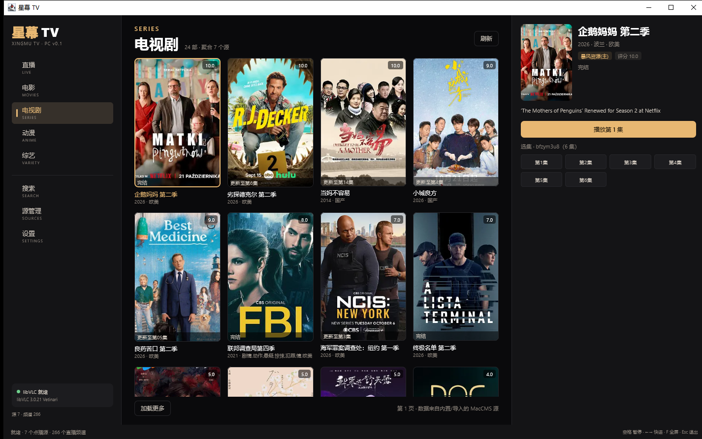
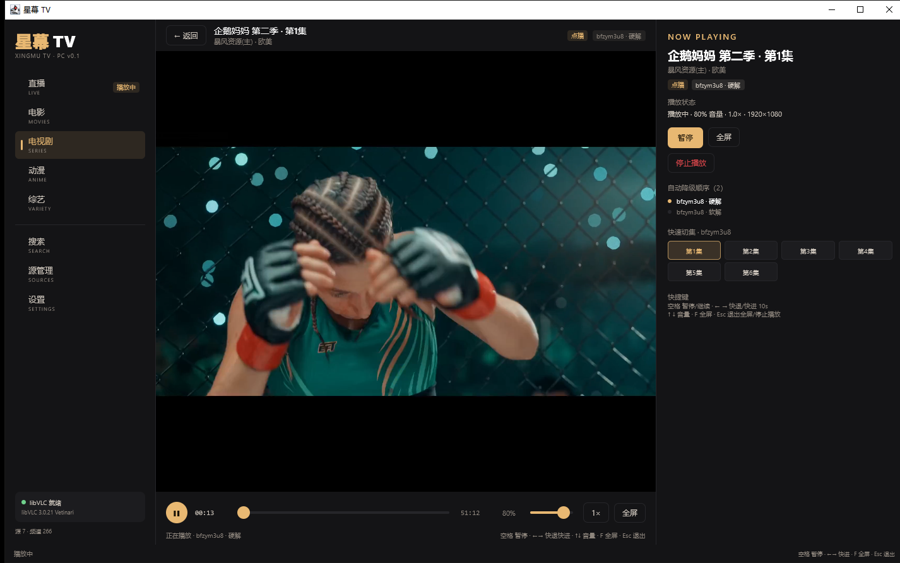
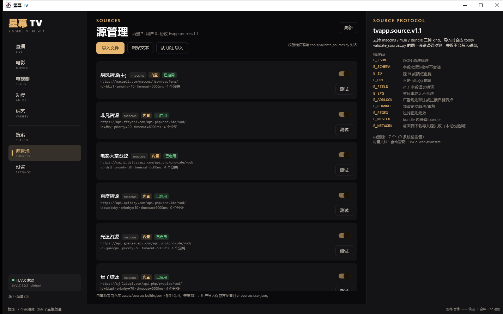
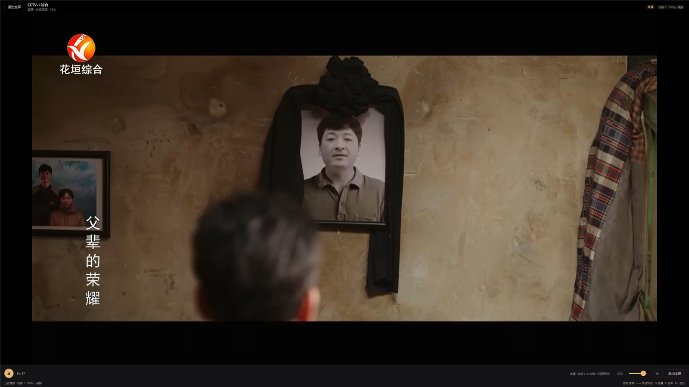

# 星幕 TV · 桌面端 v0.2.0（Windows / macOS）

Compose Multiplatform Desktop（Kotlin/JVM）+ libVLC（vlcj）实现的 PC 客户端。与 Android 端共用
`assets/` 内置数据与 `tvapp.source.v1.1` 源协议，但 UI 按桌面习惯重做成三栏式（左导航 / 中内容 / 右信息），
不复用 TV 焦点模型。


| 点播列表 | 点播播放 |
| --- | --- |
|  |  |

| 源管理 | 全屏直播 |
| --- | --- |
|  |  |

> 截图为 v0.1 的桌面布局；v0.2 的直播分组/分页/收藏已做启动实测，续播与点播收藏交互见「验证」段的 PENDING_DEVICE 说明。

## 快速开始

环境要求：**JDK 17**、**Gradle 8.7**（工程自带 wrapper）、**VLC 3.x**（libVLC）。

```bash
cd desktop

# 开发运行（自动向上查找仓库 assets/）
./gradlew run

# 指定 VLC 位置（不设置时自动检测常见安装目录）
TVAPP_VLC_HOME=/Applications/VLC.app/Contents/MacOS ./gradlew run

# 非交互自检：内置源 → 直播种子 → MacCMS list/detail → libVLC 实播直播 + 点播
./gradlew run --args="--smoke"

# Windows 安装包（Compose 插件会自动下载 WiX 3；也可用本机 WiX 放到 PATH）
./gradlew packageMsi
./gradlew packageExe

# 一次打两个包并复制到仓库根 release/，打印 size + sha256
./gradlew stageRelease

# macOS（必须在 macOS 上执行）
./gradlew packageDmg
```

Windows 辅助脚本（自动定位本机 JDK / Gradle / WiX / VLC）：

```powershell
pwsh -NoProfile -File tools/run-dev.ps1
pwsh -NoProfile -File tools/package-windows.ps1
```

## v0.2.0 新增

### 播放进度 / 继续观看
- 存储：`AppPaths.configDir/progress.json`（Windows `%APPDATA%\XingmuTV`，macOS
  `~/Library/Application Support/XingmuTV`），**原子写**（同目录 `.tmp` + `move`）。
- 字段与 Android `WatchProgress` 对齐：`vodId / sourceId / name / pic / playFrom / episodeIndex /
  episodeTitle / positionMs / durationMs / updatedAt`，并附 `watched` 集合存已看完集。
- 写入时机：播放中每 **15s**、暂停、切集、退出播放（含关闭窗口）各落盘一次。
- 阈值：`position < 60s 且 < 5%` 不记；`≥95%` 记为该集已看完，`episodeIndex` 前进到下集、位置归零。
- 读取：
  - 浏览页顶部「继续观看」横排（最多 8 条，按 `updatedAt` 倒序，可单条 × 移除）；
  - 详情面板按钮显示「继续观看 · 第 N 集 12:34」；
  - 点击后续播：先拉取详情，libVLC 起播、拿到时长后 seek 到保存位置；
  - 选集列表里已看完的集显示 `✓`。

### 收藏 / 最近
- 点播收藏（`sourceId + vodId`）与直播收藏（`channelId`）都写入 `favorites.json`，原子写、按 key 去重、可取消。
- 直播最近观看写入 `recent.json`：最多 20 条、按 channel id 去重、时间倒序。
- UI：频道行/频道详情有「☆ 收藏 / ★ 已收藏」；直播分组末尾提供「收藏」「最近」。

### 直播分组对齐 Android
顺序固定为：

1. **高清专区**（`live_hd.json` 的 114 台，按 `name + group` 与种子匹配）
2. **央视**（`group_id=cctv`，28）
3. **卫视**（`group_id=satellite`，26）
4. **地方**（`group_id=local`，212）
5. **收藏**
6. **最近**

- 地方组每页 60 台，共 **4 页**（60/60/60/32），UI 显示「第 x/4 页」并提供上一页/下一页；
- 每组 chip 角标显示真实数量；`live_hd.json` / `live_seed.json` 只读引用，不复制进源码树。

### 版本
- Gradle `version = "0.2.0"`，jpackage `packageVersion = "0.2.0"`；
- 构建时生成 `XingmuTV-version.properties`，`BuildInfo.version` 从 classpath 读取，设置/关于与左侧导航不再硬编码版本号。

## 已实现（v0.1 基线 + v0.2）

### 工程
- 独立 Gradle 工程 `desktop/`：Gradle 8.7 + Kotlin 2.0.21 + Compose Multiplatform 1.7.3 + vlcj 4.8.2
- 产物配置：Windows `.msi` / `.exe`，macOS `.dmg`（jpackage；mac 包需在 macOS 或 CI matrix 上打）
- 不修改仓库根构建脚本、`app/` 或任何 Android 代码

### 数据层（纯 JVM，不依赖 Android）
- `SourceSpecParser`：解析/校验 `tvapp.source.v1 / v1.1`，错误码与 `tools/validate_sources.py` 对齐
  （`E_JSON / E_SCHEMA / E_ID / E_URL / E_FIELD / E_EPG / E_ADBLOCK / E_CHANNEL / E_REGEX / E_NESTED`，
  下载失败额外用 `E_NETWORK` 提示）
- MacCMS `ac=list` 分类树、`ac=detail&t=` 列表、`ac=detail&ids=` 详情、`wd=` 搜索；多端点降级
  （`baseUrl → fallbackBaseUrls`）；源未配置 `categories` 时用 `ac=list` 中文分类名自动映射
- SWR 文件缓存：列表 5 分钟 / 详情 30 分钟；网络失败回退过期缓存（stale）
- 多源聚合搜索：并发查询所有启用的 MacCMS 源，同名 + 年份合并，记录可用源数
- 直播种子：`assets/live_seed.json`（266 频道 / cctv 28 / satellite 26 / local 212），
  线路按实测清晰度排序，`fallback_only` 置底；`live_hd.json` 高清标记
- UA / Referer 与 Android 端一致（`Http.DEFAULT_UA` / `Http.DEFAULT_REFERER`）
- 内置数据相对引用仓库 `assets/`，源码树不复制；构建时仅把内置 JSON 复制进 jar 作为打包后的兜底

### 播放
- libVLC 播 HLS 直播与 mp4/m3u8 点播，支持暂停/seek/音量/倍速（0.5×–2×）/全屏
- **1080p 黑屏降级**：每条线路按「硬解 → 软解（`:avcodec-hw=none`）→ 更低清晰度线路」自动重试；
  轮询 `state/time/videoOutputs` 判定解码错误、连接超时、无视频输出（黑屏）
- 续播 seek：libVLC 拿到时长后跳到 `PlaybackRequest.startPositionMs`
- 右侧面板显示当前尝试的完整降级阶梯，失败切换时给出可读提示
- 画中画（PiP）仍为后续计划

### 界面
- 三栏式：左侧导航 / 中部列表或播放器 / 右侧详情与线路、剧集
- 暗色 A 影院主题，与 Android 一致：`#0A0A0C` 背景 + `#E8B872` 金色强调
- 键盘快捷键（AWT 级分发，避免 AWT Canvas 抢焦点）：
  `空格` 暂停/继续、`←/→` 快退/快进 10s、`↑/↓` 音量 ±5%、`F` 全屏、`Esc` 退出全屏/停止播放
- 源管理：本地 JSON 文件 / 粘贴文本 / URL 导入；导入失败展示错误码；源可启停、测试连通、删除用户源
- 设置：libVLC 路径与检测、画质上限、硬件解码开关、默认音量、缓存清理、配置/缓存目录、版本号（构建注入）

## PC 客户端依赖 libVLC

播放依赖系统安装的 libVLC 3.x（vlcj 4.8.2 只是 JVM 绑定，**不包含原生库**）。

| 平台 | 获取方式 | 默认检测位置 |
| --- | --- | --- |
| Windows | 安装 [VLC 3.0.x 64 位](https://www.videolan.org/vlc/) 桌面版；或解压 portable zip | `%ProgramFiles%\VideoLAN\VLC`、`%ProgramFiles(x86)%\VideoLAN\VLC`、`%LOCALAPPDATA%\Programs\VideoLAN\VLC`、`PATH` |
| macOS | 把 `VLC.app` 放入 `/Applications`（[下载](https://www.videolan.org/vlc/)） | `/Applications/VLC.app/Contents/MacOS/lib`、Homebrew `/opt/homebrew/lib`、`/usr/local/lib` |
| Linux（开发） | `sudo apt install libvlc-dev vlc-plugin-base` | `/usr/lib/x86_64-linux-gnu`、`/usr/lib`、`/usr/local/lib` |

找不到原生库时：

1. 应用不会崩溃，窗口与列表仍可用；播放按钮会提示「未找到 libVLC」并跳到设置。
2. 在 **设置 → libVLC 播放器** 里填写 VLC 安装目录（或 `libvlc.dll` / `VLC.app` 路径），点「保存并检测」。
3. 或设置环境变量 `TVAPP_VLC_HOME`（也支持 `VLC_HOME`、`-Dtvapp.vlc.home`）。
4. 已安装 VLC 的机器通常无需任何配置。

> v0.2 的 MSI/EXE **不内置** libVLC 原生库（体积 + 许可证考虑）。如果随包分发，把 VLC 安装目录
> 整个复制到应用可执行文件旁的 `vlc/` 子目录即可命中检测（`user.dir/vlc`）；或引导用户安装 VLC。

## 目录

```
desktop/
├── build.gradle.kts / settings.gradle.kts   # 独立工程，不污染 Android 构建
├── gradle/wrapper + gradlew(.bat)
├── src/main/kotlin/com/tvbox/desktop/
│   ├── Main.kt               # 入口 / CLI（--smoke、--autoplay-live、--vlc、--assets）
│   ├── BuildInfo.kt          # 从构建生成的 version.properties 读版本
│   ├── data/                 # 源协议、MacCMS、直播目录、进度/收藏/最近、SWR、聚合
│   ├── player/               # libVLC 定位、播放控制器、降级阶梯、续播 seek
│   ├── ui/                   # 三栏界面、继续观看、收藏、直播分组、播放器、源管理、设置
│   └── smoke/SmokeRunner.kt  # 非交互验收
└── src/test/kotlin/...       # 52 个单元测试
```

## 验证

```bash
cd desktop
./gradlew test --no-daemon
./gradlew compileKotlin --no-daemon
./gradlew stageRelease
```

- `test`：**52/52 通过**（新增覆盖进度阈值/最近一条/≥95% 看完、收藏去重与增删、最近去重与上限 20、
  直播分组顺序与 114/28/26/212 数量、地方 4 页、版本资源）。
- `compileKotlin`：通过。
- GUI 启动实测（Windows + VLC 3.0.21）：版本显示 `v0.2.0`；分组 chip 为高清专区 114 / 央视频道 28 /
  卫视频道 26 / 地方频道 212 / 收藏 0 / 最近 1，地方组显示「第 1/4 页 · 每页 60 台」；点击直播收藏后
  角标变 收藏 1、按钮变「★ 已收藏」。
- **续播/继续观看、点播收藏的 GUI 交互未实测 → PENDING_DEVICE**（本任务不要求 GUI 实拍）；
  v0.1 曾实测直播/点播播放、`F` 全屏、空格暂停（截图见上），数据层链路以单元测试与 smoke 为准。

### v0.2.0 产物（本机 Windows 构建）

| 文件 | 大小 | SHA256 |
| --- | --- | --- |
| `release/XingmuTV-0.2.0.msi` | 57,878,919 bytes | `0241f02d054e402bd8f19d16c718ea46f9b27f236e0044f4d440ee868e4f152d` |
| `release/XingmuTV-0.2.0.exe` | 58,539,520 bytes | `a5228a49075a903a421d0ad3e5777f57955e7fd2253106cd49c0c03629b35ac5` |

构建命令：`./gradlew stageRelease`（依赖 `packageMsi` + `packageExe`，复制到仓库根 `release/` 并打印校验值），
日志：`.artifacts/desktop/t35-package1.log`。

## 已知限制

- **macOS `.dmg` 未在本机构建**（需 macOS/CI matrix）；本机只验证 Windows MSI/EXE。
- v0.2 续播/继续观看与点播收藏的 GUI 交互未实测（PENDING_DEVICE）；进度/收藏存储与分组逻辑由 52 项单测覆盖。
- 画中画、字幕选择仍为后续候选。
- m3u 源目前只做协议校验与展示；直播使用 `live_seed.json`。
- 直播时移取决于源是否支持，UI 对直播只提供 ±10s。
